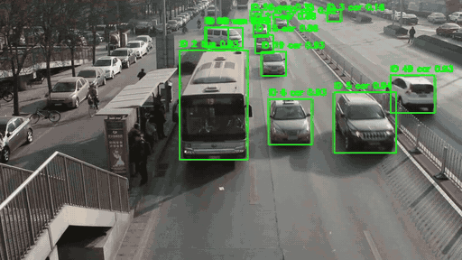

# Road Perception C++

基于 **YOLOv8s + ByteTrack** 的道路车辆检测与多目标跟踪项目。Python 负责数据准备、训练和模型导出，C++ 负责视频检测与跟踪。

- 支持 `car`、`bus`、`van`、`others` 四类车辆。
- UA-DETRAC 固定划分为 48 个训练序列、12 个验证序列。
- 为全部 60 个序列生成视频并执行检测与跟踪。
- 提供训练权重和 ONNX 模型；运行结果统一保存到 `runs/`。

## 演示

[](assets/demo.mp4)

[查看演示视频](assets/demo.mp4) · MVI_20012 · YOLOv8s + ByteTrack · C++ 推理

## 项目结构

```text
road_perception_cpp/
├── prepare_data.py        # 数据准备
├── train.py               # 模型训练
├── export_onnx.py         # ONNX 导出
├── make_videos.py         # 全部序列生成视频
├── infer.py               # 全部序列检测与跟踪
├── evaluate.py            # 验证集检测评价
├── src/road_perception/   # Python 实现模块
├── cpp/                   # C++ 推理与跟踪
├── configs/               # 参数配置与序列划分
├── assets/                # 演示动图与视频
├── third_party/           # ByteTrack 源码与本地运行库
└── runs/                  # 模型权重和运行结果
```

## 环境配置

创建并激活环境：

```bash
conda create -n road -c conda-forge --override-channels \
  python=3.10 pip cmake=3.31 make cxx-compiler \
  libopencv=4.11 eigen=3.4 wget \
  cuda-version=12.6 cuda-libraries=12.6 cudnn=9.7 -y
conda activate road
```

安装 PyTorch 和项目依赖：

```bash
python3 -m pip install torch==2.7.0 torchvision==0.22.0 --index-url https://download.pytorch.org/whl/cu126
python3 -m pip install -r requirements.txt
```

下载 C++ 使用的 ONNX Runtime：

```bash
mkdir -p third_party
wget -c https://github.com/microsoft/onnxruntime/releases/download/v1.19.2/onnxruntime-linux-x64-gpu-1.19.2.tgz
tar -xzf onnxruntime-linux-x64-gpu-1.19.2.tgz -C third_party
```

## 数据配置

```bash
export DATA_ROOT=/media/pml/work/dataset
```

`configs/dataset.yaml` 中的数据路径相对于 `DATA_ROOT`：

```yaml
annotations: ua_detrac/raw/Annos/DETRAC-Train-Annotations-XML
images: ua_detrac/raw/DETRAC-Images
processed: ua_detrac/processed
videos: ua_detrac/videos
```

```text
$DATA_ROOT/ua_detrac/
├── raw/
│   ├── Annos/DETRAC-Train-Annotations-XML/
│   └── DETRAC-Images/MVI_*/img*.jpg
├── processed/
└── videos/
```

## 数据准备

```bash
python3 prepare_data.py
```

## 使用已有权重推理

使用 `runs/weights/best.onnx` 处理全部 60 个序列：

```bash
python3 make_videos.py
cmake -S . -B build -DCMAKE_BUILD_TYPE=Release -DCMAKE_PREFIX_PATH="$CONDA_PREFIX"
cmake --build build -j4
python3 infer.py
```

推理配置：`configs/inference.yaml`。跟踪配置：`configs/tracker.yaml`。

## 模型训练与导出

```bash
python3 train.py
python3 export_onnx.py
```

训练配置：`configs/train.yaml`。模型保存到 `runs/weights/`。

## 检测评价

```bash
python3 evaluate.py --backend pt
python3 evaluate.py --backend onnx
```

## 检测结果

项目固定划分：48 个训练序列、12 个验证序列；指标统计于验证集。

| 后端 | Precision | Recall | mAP@0.5 | mAP@0.5:0.95 |
|---|---:|---:|---:|---:|
| PyTorch | 0.8203 | 0.7723 | 0.8127 | 0.6519 |
| ONNX | 0.8305 | 0.7631 | 0.8124 | 0.6419 |

## C++ 运行结果

| 项目 | 结果 |
|---|---:|
| 完成序列 | 60 |
| 处理帧数 | 83,791 |
| 核心流水线 FPS（不含视频 I/O 与绘图） | 116.27 |
| 端到端 FPS | 62.39 |

## 结果目录

```text
runs/
├── weights/
│   ├── yolov8s.pt         # 预训练权重
│   ├── best.pt            # 最佳训练权重
│   ├── last.pt            # 最后一轮权重
│   └── best.onnx          # C++ 部署模型
├── training/
│   ├── results.csv        # 每轮训练损失与检测指标
│   └── curves/            # 训练曲线
├── videos/                # 各序列检测与跟踪视频
├── tracks/                # 各序列轨迹 CSV
├── timing/                # 各序列逐帧耗时 CSV
├── evaluation/
│   ├── detection_pt.csv
│   ├── detection_onnx.csv
│   └── detection.csv
└── summary.csv            # 各序列帧数、轨迹数、耗时与 FPS
```

第三方代码来源及许可证见 [third_party/README.md](third_party/README.md)。
